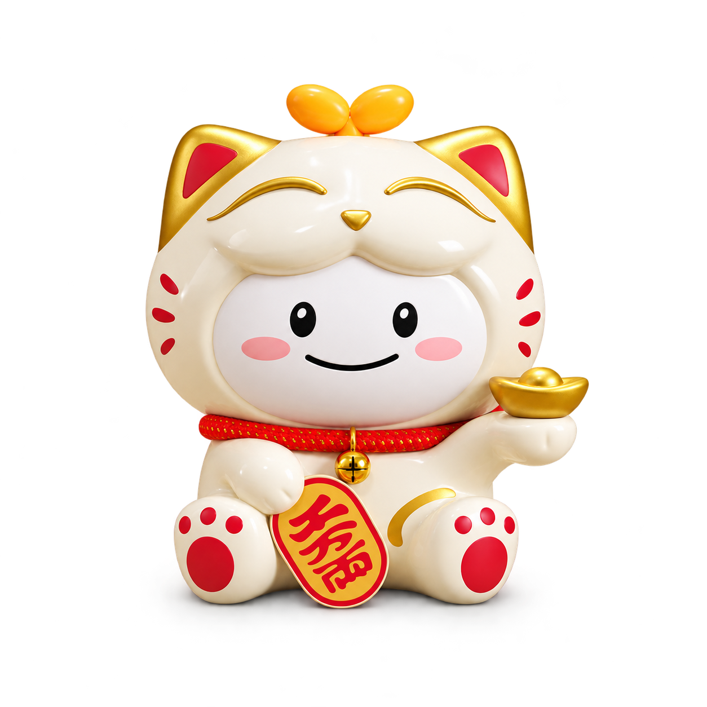
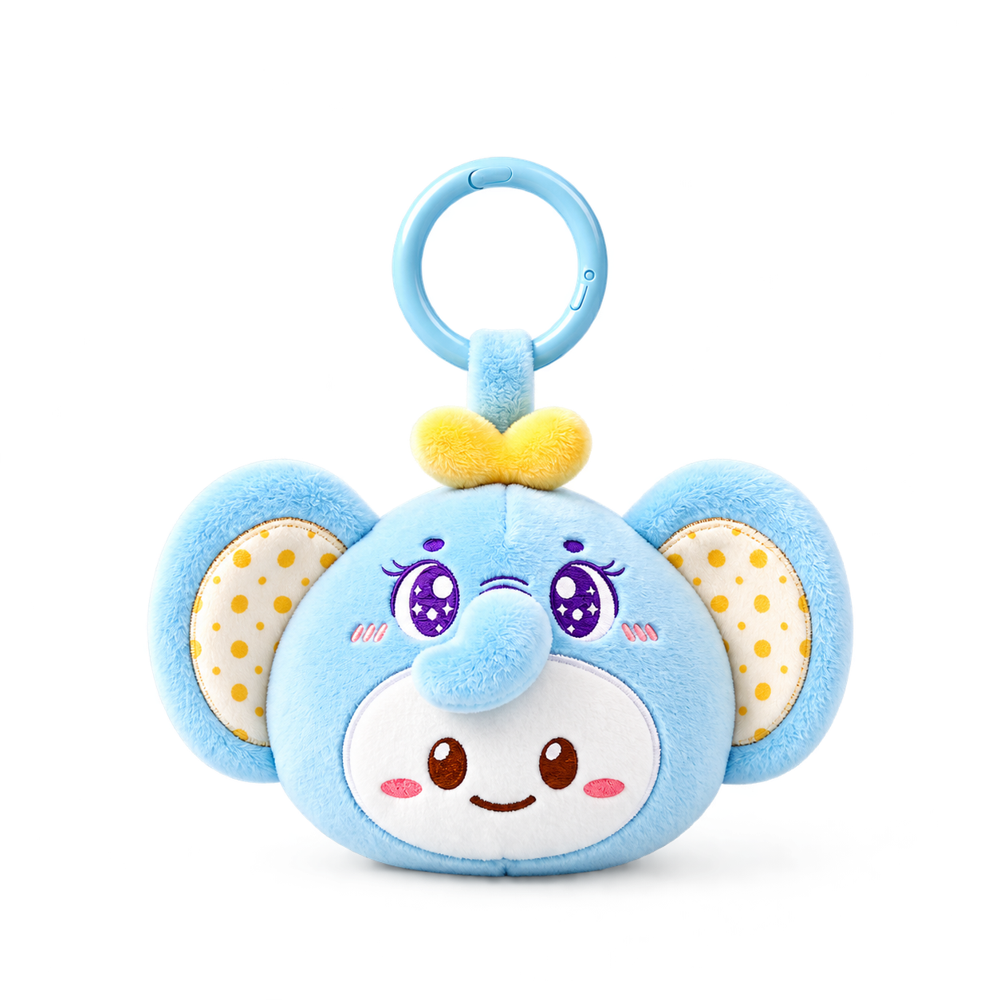
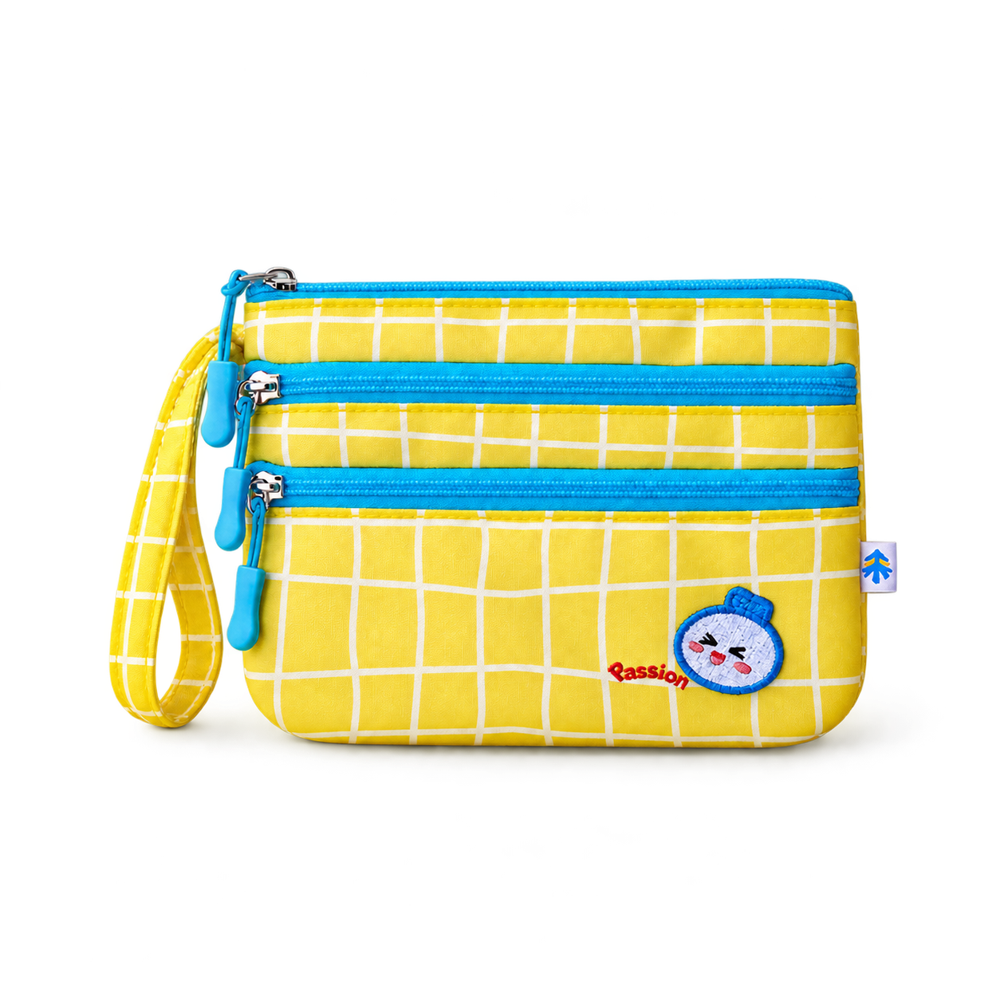
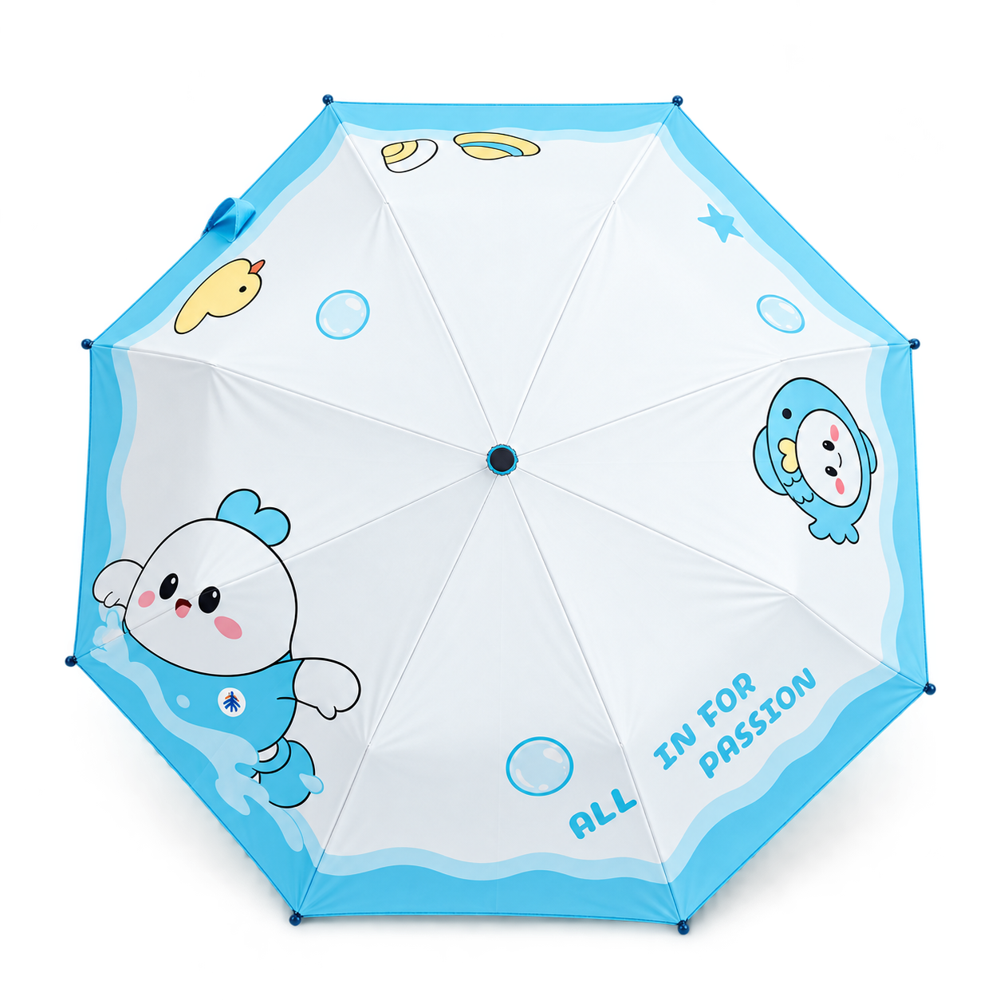
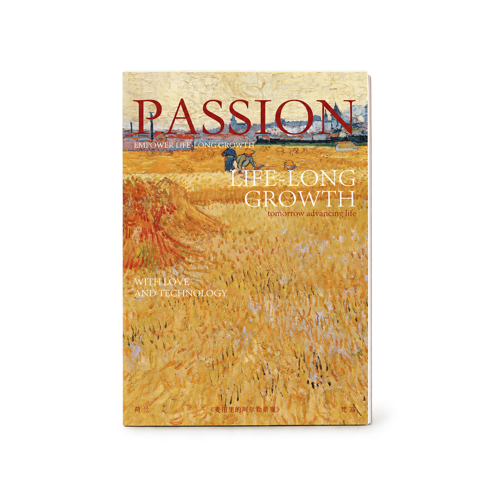
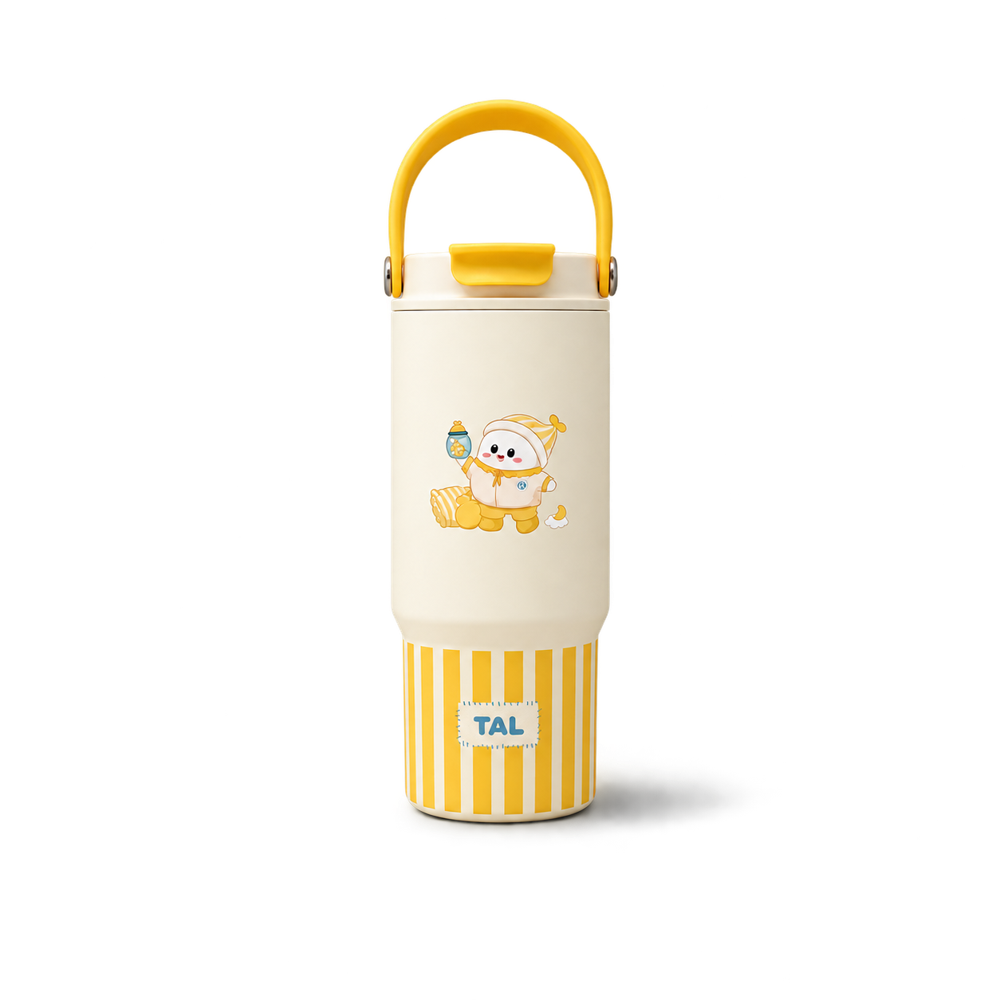

# Product Cutout · 透明投影商品图

把商品链接或商品照片，处理成透明背景、柔和落地投影的网页商品 PNG。



## 效果

- 真实 Alpha 透明背景，适合网页商品卡片和产品展示。
- 中性灰接触阴影，轻柔向右延伸、渐隐到透明。
- 方形画布，主体限制在中间 66% × 66% 安全区，含可见投影的整体限制在中间 82% × 82%，四周透明留白。
- 按轮廓与视觉体量统一产品大小，小配件略小、大包及抱枕略大，主体不必撑满安全区。
- 以输入原图为准，保留商品颜色、造型、材质、图案和拍摄角度。
- 支持商品原图或可读取的商品页面链接，包括有赞商品页。

这是给 Codex 使用的指令型 skill，不是独立抠图程序。生成式编辑可能改变复杂图案、文字和细小结构，交付前需要对照原图检查。

## 默认尺寸规范

以 1000 × 1000 画布为例：完整主体放在中间 660 × 660 区域（四周至少 170 像素）；主体与可见投影放在中间 820 × 820 区域（四周至少 90 像素）。极淡的投影尾部完整保留，距离画布边缘至少 1%。视觉中心优先位于横向 50%、纵向 49%，安全留白优先。

66% 是宽、高的上限，不是面积比例，也不要求每件商品撑满。生成提示词、尺寸核对和批量视觉体量计算均采用这套规则，详见 [视觉尺寸规范](skills/artifact-template-product-cutout/references/visual-sizing.md)。

## 更多效果示例

以下 6 张选自项目已有商品展示图，用于说明希望复现的透明背景、商品质感和投影效果；它们不是本次运行该 skill 新生成的结果，也不构成效果评测。所有示例均为 1254 × 1254、带 Alpha 通道的 PNG。它们是历史风格示例，部分主体占比可能大于新规范；后续生成的尺寸以 66%／82% 安全区为准。

| 毛绒挂件 | 布艺手包 | 金属徽章 |
| :---: | :---: | :---: |
|  |  |  |
| 毛绒与刺绣边缘 | 布料、拉链和手带 | 金属边框与珐琅反光 |

| 晴雨伞 | 笔记本 | 手提保温杯 |
| :---: | :---: | :---: |
|  |  |  |
| 浅色面料与不规则轮廓 | 印刷图案与平直边缘 | 提手镂空与落地投影 |

图片文件见 [examples](examples/)，品名和文件校验信息见 [manifest.json](examples/manifest.json)。示例图的权益范围见 [NOTICE.md](NOTICE.md)。

## 安装

在支持 skill 的 Codex 环境中，对 Codex 说：

```text
使用 $skill-installer，从 https://github.com/xchangee/product-cutout-skill 安装 skills/artifact-template-product-cutout
```

也可以下载本仓库，将 `skills/artifact-template-product-cutout` 整个文件夹复制到当前环境支持的个人 skills 目录，或项目的 `.agents/skills/` 目录。不要只复制 SKILL.md，参考图和元数据也需要保留。

有关本地目录和 skill 安装机制，参见 [OpenAI 官方文档](https://developers.openai.com/codex/skills)。如果新 skill 没有出现，可重启 Codex。

## 使用

安装后输入 skill 名称，附上商品链接或原图：

```text
使用 $artifact-template-product-cutout，把这个商品处理成透明背景、柔和投影、主体 66% 安全区、投影 82% 安全区且视觉大小统一的网页商品 PNG：[商品链接或附图]
```

可以补充“保留包装盒”“投影更淡”“主体大一点”等要求。默认只生成图片，不修改或发布网站。

## 运行条件

- Codex 环境需提供图片编辑和透明背景输出能力；本工作流使用内置 `image_gen`，并参考 `$imagegen` skill。
- 使用商品链接时，需要能访问该页面及其商品原图。页面受登录或访问限制时，可直接上传原图。
- 本 skill 不包含 API 调用脚本，不需要在仓库中配置密钥；具体工具可用性和使用额度取决于运行环境。
- 输出为透明 PNG，尺寸以生成工具实际返回为准；随附参考为 1254 × 1254。

## 文件结构

```text
skills/artifact-template-product-cutout/
├── SKILL.md                  # 工作流、质量要求和编辑提示词
├── artifact-template.json    # 参考图与预览图路径
├── agents/openai.yaml        # skill 显示信息
├── references/visual-sizing.md # 尺寸规则、量化方法与验收
└── assets/
    ├── reference.png         # 风格参考
    └── preview.png           # 预览
```

参考图仅控制透明背景、边缘和投影风格；尺寸与留白以文字安全区规范为准；每次输入的商品原图决定商品外观。仓库不包含商品原始照片、商店链接、本机路径、内部站点或凭据。

## 许可

工作流文字、提示词和配置采用 [MIT License](LICENSE)。随附商品示例图不在 MIT 授权范围内，参见 [NOTICE.md](NOTICE.md)。使用自己的商品图片时，请确认相应使用权限。

## English

A Codex skill for creating transparent product PNGs with subtle contact shadows and square-canvas padding. Provide a product photo or an accessible product URL, then invoke `$artifact-template-product-cutout`. Requires an image-editing tool with reference-image and alpha-transparency support. It is an instruction workflow, not a standalone background-removal application.
